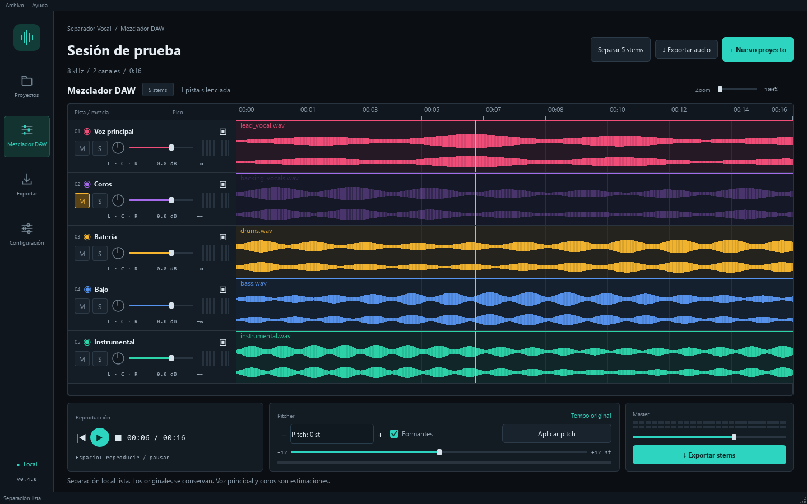
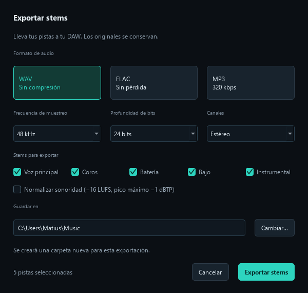
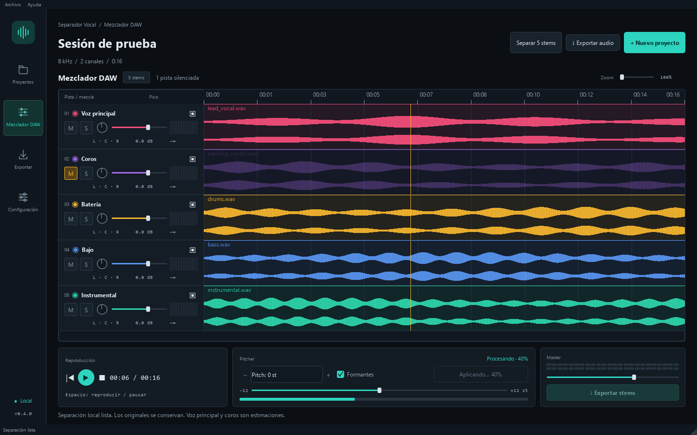

# Validación del rediseño Figma

Fecha: 22 de octubre de 2026. Base: `develop` / `8452399`.
Rama: `codex/frontend-figma-refactor`.

## Comprobaciones ejecutadas

| Comprobación | Resultado |
| --- | --- |
| `./.venv/Scripts/python.exe -m unittest discover -s tests -v` | 33 pruebas, todas correctas |
| `./.venv/Scripts/python.exe -m compileall -q src` | Código de salida 0 |
| `./.venv/Scripts/python.exe -m vocal_splitter --diagnostics-ui` | Apertura y cierre de la ventana nativa, código 0 |
| `git diff --check` | Sin errores |

Las pruebas nuevas cubren salida de audio con panorama/master y margen de pico, medidores, controles de mezcla, búsqueda sincronizada, conservación de mezcla y posición al cargar un render, zoom compartido, selección de exportación, conversión real con FFmpeg a WAV/FLAC/MP3, limpieza ante error, progreso por pista y un render real con Rubber Band y formantes que conserva duración y fuente. La prueba de interfaz comprueba navegación, ventana de 940 × 650, nombre de canción largo y prevención del cierre durante una importación.

La suite conserva una prueba que simula un fallo del separador instrumental. Su traceback es esperado: la prueba verifica la recuperación de resultados parciales y termina correctamente.

## Revisión visual

Se inspeccionaron los tres frames en el navegador y el frame principal de 1440 × 900 en el editor. Se generaron y revisaron capturas Qt del estado vacío, el mezclador, el diálogo de exportación, el progreso de pitch y la ventana mínima. Las capturas usan audio sintético temporal y el nombre «Sesión de prueba»; no representan una separación musical real.

La distribución, paleta, jerarquía y colores de pista siguen el prototipo. La implementación conserva el marco nativo de Windows y muestra datos reales del audio, en lugar de copiar el título, BPM o cifras musicales de muestra. No se ha implementado un tema claro: las tres vistas de referencia corresponden al tema oscuro. «Proyectos» permite importar y volver al mezclador actual; no incorpora una biblioteca histórica adicional.

## Revisión de código

- El tema, carriles, controles gráficos, navegación y exportación se encuentran en módulos de UI separados. El mezclador y las opciones de exportación conservan sus respectivas responsabilidades.
- Los formatos y parámetros se validan antes de convertir. FFmpeg se ejecuta con argumentos estructurados, sin shell; los archivos originales no se sobrescriben.
- Las tareas de exportación y pitch permanecen en workers. La navegación/importación/separación comprueba tareas activas para no destruir sus propietarios.
- No se añadieron dependencias. Modelos, muestras y cachés permanecen excluidos de Git.

## Límites de esta validación

No se volvió a ejecutar la descarga ni la inferencia de los cuatro modelos: el motor de separación no se modificó. No se realizó una nueva escucha subjetiva de canciones completas ni se generó o publicó un instalador. El cambio se entrega en código fuente y capturas; el instalador publicado de 0.4.0 conserva la interfaz anterior.
